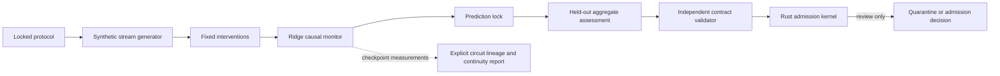

# Monorepo architecture

State slice: `aligned-holistic-continual-learning-integrated-stack-v2`.

The system separates scientific computation from authority. The runner creates
an aggregate-only result. The validator checks that result against the locked
contract. The Rust kernel models a later admission decision; it has no access
to model weights, traces, providers, or mutable capability state.

The integrated model-backed slice has those identities in the external custody
root and review packet. Execution remains closed until an independent receipt
accepts the exact packet, so the repository still publishes only the synthetic
qualification until that gate is satisfied.

The adapter ports in `src/ahcl/interfaces.py` are the intended consolidation
point. Activation capture, feature encoding, interventions, and behavior
scoring remain separate capabilities with typed boundaries. The pinned
upstream projects are available as immutable submodules, while every runtime
adapter remains disabled until the integrated review gate passes. This keeps a
convenient backend import from silently turning a synthetic qualification into
model evidence.

`src/ahcl/continuity.py` provides the model-free Theseus-style measurement
boundary. It accepts only aggregate checkpoint measurements and explicit
caller-supplied lineage edges. It reports representation, circuit,
intervention, and behavioral continuity independently; it can identify the
bounded pattern of behavioral equivalence with mechanistic drift, but it does
not establish mechanistic understanding, alignment, continual-learning
superiority, or production readiness.
