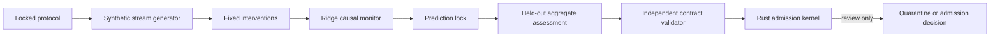

# Monorepo architecture

State slice: `aligned-holistic-continual-learning-clean-room-v1`.

The system separates scientific computation from authority. The runner creates
an aggregate-only result. The validator checks that result against the locked
contract. The Rust kernel models a later admission decision; it has no access
to model weights, traces, providers, or mutable capability state.

The research boundary is explicit. A future model-backed slice would need a
fresh corpus and custody manifest, exact runtime and model identities, an
independent review receipt, and a new claim ceiling. None of those inputs are
present in this repository.
